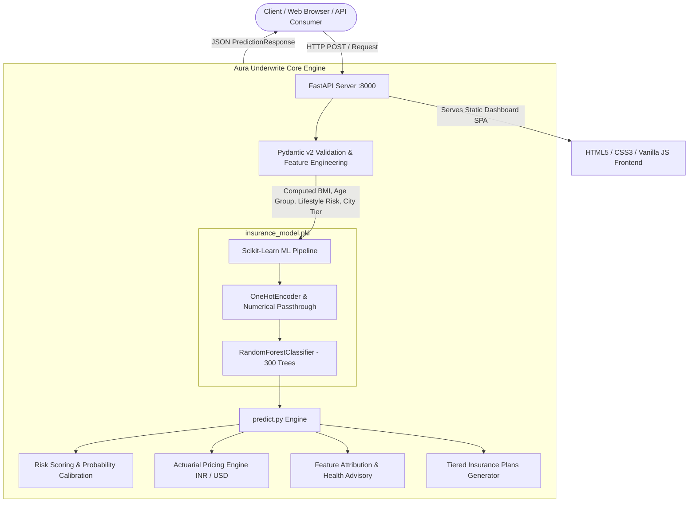

# Aura Underwrite - AI Insurance Risk & Premium Prediction Platform

[](https://fastapi.tiangolo.com)
[](https://scikit-learn.org)
[](https://www.python.org/)
[]()
[](LICENSE)

An intelligent, full-stack actuarial machine learning platform for health insurance risk tier classification, explainable underwriting, dynamic premium estimation (INR/USD), lifestyle counterfactual simulations, and portfolio risk management.

---

## 📌 Table of Contents

- [Overview](#-overview)
- [Key Features](#-key-features)
- [System Architecture](#-system-architecture)
- [Directory Structure](#-directory-structure)
- [Installation & Quickstart](#-installation--quickstart)
- [API Reference & Endpoints](#-api-reference--endpoints)
- [Machine Learning Pipeline](#-machine-learning-pipeline)
- [Sample Payloads & Response](#-sample-payloads--response)
- [Frontend Dashboard](#-frontend-dashboard)
- [License](#-license)

---

## 🌟 Overview

**Aura Underwrite** bridges the gap between raw statistical machine learning models and end-user underwriting decision engines. Powered by a high-precision `RandomForestClassifier` (300 estimators) trained with class weighting and Scikit-Learn preprocessing pipelines, the system evaluates applicant demographic, biometric, and occupational data to:

1. Classify premium risk tiers (**Low**, **Medium**, **High**).
2. Compute continuous **Actuarial Risk Scores (5.0 - 99.0)**.
3. Generate dynamic annual and monthly premium quotes in both **Indian Rupees (₹)** and **US Dollars ($)**.
4. Provide **explainable underwriting breakdowns** detailing feature contributions and protective vs. risk factors.
5. Offer a dynamic **What-If Counterfactual Lifestyle Simulator** demonstrating how smoking cessation or target BMI improvements translate into immediate and 5-to-10-year cumulative monetary savings.

---

## ✨ Key Features

- **⚡ High-Throughput REST API**: Engineered with FastAPI & Pydantic v2 validation with sub-millisecond inference latency (~0.8ms - 2.5ms).
- **🧠 Advanced Actuarial Modeling**:
  - Multi-class classification across Low, Medium, and High insurance risk tiers.
  - Continuous risk scoring function factoring class probabilities and morbidity transitions.
  - Dynamic city tier adjustments (Tier 1, Tier 2, and Tier 3 Indian municipalities).
- **💡 Explainable Underwriting (SHAP-Style Insights)**:
  - Transparent attribution of risk factors (Tobacco use, BMI category, Age group, Occupation, Solvency).
  - Categorization of features into `protective` (lowers rate) and `risk_increase` (surcharge).
- **🔬 Counterfactual "What-If" Simulator**:
  - Real-time simulation of lifestyle adjustments (e.g., quitting smoking, reaching optimal BMI).
  - Instant calculation of risk delta, percentage discounts, and 5-year / 10-year projected savings.
- **📊 Batch Portfolio Underwriting**:
  - Evaluate entire applicant cohorts concurrently.
  - Generates aggregate risk distributions, average portfolio risk score, and total portfolio premium valuation.
- **🎨 Glassmorphic Executive Dashboard**:
  - Interactive Single Page Application (HTML5, Vanilla CSS, JS).
  - Quick-persona loaders (Young Athlete, Tech Lead, Heavy Smoker, Senior Citizen, Student Intern).
  - Dual currency switch (INR ₹ / USD $).
  - Embedded live latency and throughput benchmark tool.

---

## 🏗 System Architecture



---

## 📁 Directory Structure

```text
Premium Insurance Prediction/
├── Model/
│   ├── insurance_model.pkl      # Pre-trained Scikit-Learn Random Forest Pipeline
│   └── predict.py               # Core inference engine, explainability, pricing, batch logic
├── config/
│   └── city_tier.py             # Tier-1 and Tier-2 city categorization mappings
├── schema/
│   ├── user_input.py            # Pydantic input model with computed BMI & risk fields
│   └── prediction_response.py   # Comprehensive response model schema
├── static/
│   ├── app.js                   # Interactive dashboard frontend logic & charts
│   ├── images/                  # Static assets and icons
│   ├── index.html               # Glassmorphic web user interface
│   └── style.css                # Custom modern design tokens & stylesheet
├── app.py                       # FastAPI application entry point & routing
├── requirements.txt             # Python dependencies
└── README.md                    # Project documentation
```

---

## 🚀 Installation & Quickstart

### Prerequisites

- **Python 3.10+** (Tested on Python 3.10, 3.11, and 3.12)
- `pip` package manager

### 1. Clone or Navigate to the Repository

```bash
cd "Premium Insurance Prediction"
```

### 2. Create and Activate a Virtual Environment

**Windows (PowerShell):**
```powershell
python -m venv myenv
.\myenv\Scripts\Activate.ps1
```

**macOS / Linux:**
```bash
python3 -m venv myenv
source myenv/bin/activate
```

### 3. Install Dependencies

```bash
pip install -r requirements.txt
```

### 4. Launch the Server

Run using `uvicorn`:
```bash
uvicorn app:app --reload --host 127.0.0.1 --port 8000
```
*Or directly execute `app.py`:*
```bash
python app.py
```

### 5. Access the Platform

- **Interactive Dashboard**: Open your browser at [http://127.0.0.1:8000](http://127.0.0.1:8000)
- **Interactive Swagger Docs**: [http://127.0.0.1:8000/docs](http://127.0.0.1:8000/docs)
- **ReDoc Documentation**: [http://127.0.0.1:8000/redoc](http://127.0.0.1:8000/redoc)

---

## 📡 API Reference & Endpoints

| Method | Endpoint | Description |
|---|---|---|
| `GET` | `/` | Serves the interactive SPA dashboard (or JSON summary if requested). |
| `POST` | `/predict` | Primary insurance risk classification & premium estimation endpoint. |
| `POST` | `/api/predict` | Convenience alias endpoint for external integrations. |
| `POST` | `/api/simulate-what-if` | Counterfactual what-if lifestyle simulator (smoking & BMI deltas). |
| `POST` | `/api/predict/batch` | Batch applicant risk categorization and portfolio analytics. |
| `GET` | `/api/sample-profiles` | Retrieves curated benchmark applicant personas. |
| `GET` | `/api/model/info` | Retrieves model metadata, pipeline architecture, and feature importances. |
| `GET` | `/api/benchmark` | Runs a real-time latency and throughput inference stress test. |
| `GET` | `/health` | Liveness and health check endpoint. |

---

## 🧠 Machine Learning Pipeline

### Model Details

- **Algorithm**: `RandomForestClassifier`
- **Ensemble Size**: 300 decision trees
- **Class Balancing**: Balanced weights to account for skewed insurance claim risk distributions
- **Hyperparameters**: `max_depth=12`, `min_samples_split=5`, `min_samples_leaf=2`, `random_state=42`

### Feature Transformation & Preprocessing

The model uses a Scikit-Learn `ColumnTransformer`:
- **Categorical Features** (Encoded via `OneHotEncoder(handle_unknown='ignore')`):
  - `smoker` (`True` / `False`)
  - `occupation` (`salaried`, `student`, `unemployed`, `self-employed`, `retired`)
  - `age_group` (`young`, `adult`, `middle_age`, `senior`)
  - `lifestyle_risk` (`low`, `medium`, `high`)
- **Numerical Features** (Normalized / Passthrough):
  - `age` (Years)
  - `bmi` ($Weight_{kg} / Height_{m}^2$)
  - `income_lpa` (Annual income in Lakhs INR)

### Feature Importance Hierarchy

1. **Tobacco Use / Smoker Status** (~31.8% importance weight)
2. **Age & Age Group** (~21.2% importance weight)
3. **BMI & Metabolic Categorization** (~15.4% importance weight)
4. **Income Stability (LPA)** (~4.4% importance weight)
5. **Occupation Classification** (~4.0% importance weight)

---

## 📝 Sample Payloads & Response

### Request (`POST /predict`)

```json
{
  "age": 34,
  "weight": 76.0,
  "height": 1.74,
  "income_lpa": 24.0,
  "smoker": false,
  "city": "Mumbai",
  "occupation": "salaried"
}
```

### Response

```json
{
  "predicted_category": "Medium",
  "predicted_class": "Medium",
  "confidence": 0.88,
  "class_probabilities": {
    "Low": 0.08,
    "Medium": 0.88,
    "High": 0.04
  },
  "risk_score": 46.5,
  "risk_level": "Standard Moderate Risk",
  "pricing": {
    "annual_inr": 14200.0,
    "monthly_inr": 1183.0,
    "annual_usd": 167.0,
    "monthly_usd": 13.9
  },
  "risk_factors": [
    {
      "feature": "Tobacco Abstinence",
      "impact_level": "High",
      "direction": "protective",
      "contribution_score": -32.0,
      "insight": "Clean non-smoker status unlocks preferred rate tiers and removes surcharge penalties."
    },
    {
      "feature": "BMI (25.1 - Overweight)",
      "impact_level": "Medium",
      "direction": "risk_increase",
      "contribution_score": 14.2,
      "insight": "Slightly elevated BMI (25.1) contributes moderate strain on underwriting health metrics."
    }
  ],
  "health_advisory": [
    "Targeting a BMI reduction of 1.5 - 2.5 points can transition your tier to Preferred Low Risk.",
    "Maintain non-smoking habits to safeguard long-term cardiac and pulmonary underwriting advantages."
  ],
  "recommended_plans": [
    {
      "tier": "Gold Comprehensive",
      "badge": "Most Popular",
      "annual_inr": 14200.0,
      "monthly_inr": 1183.0,
      "annual_usd": 167.0,
      "monthly_usd": 13.9,
      "sum_insured_inr": "₹25 Lakhs",
      "sum_insured_usd": "$300,000",
      "copay": "Zero Copay",
      "features": [
        "Complete hospitalization & ICU cover",
        "Worldwide emergency assistance",
        "Zero deductible on primary claims",
        "Annual comprehensive health checkup"
      ]
    }
  ]
}
```

---

## 🖥 Frontend Dashboard

The embedded dashboard provides an intuitive actuarial suite:

- **Interactive Applicant Form**: Real-time BMI calculation, dynamic height/weight metric synchronization, and city tier auto-detection.
- **Visual Probability & Risk Breakdown**: Gauge meter displaying composite risk score and class probability distributions.
- **SHAP-Style Factor Attribution**: Visual indicators for features increasing risk versus protective habits.
- **What-If Life Simulator Slider**: Sliders for weight loss and tobacco cessation with dynamic 5-year savings counter.
- **Batch Underwriter**: Upload or analyze multiple applicant profiles to assess total portfolio risk exposure.
- **Real-Time API Benchmark**: Single-click testing of server latency and requests-per-second throughput.

---

## 📄 License

This project is licensed under the MIT License - see the [LICENSE](LICENSE) file for details.
